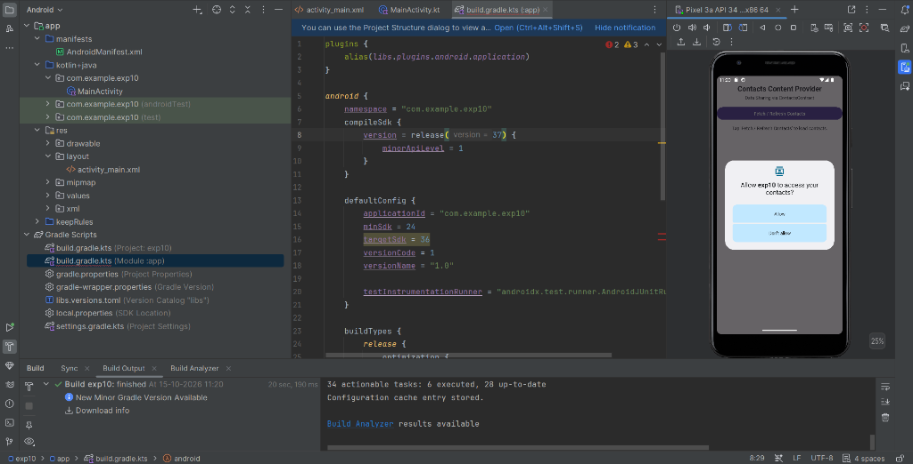
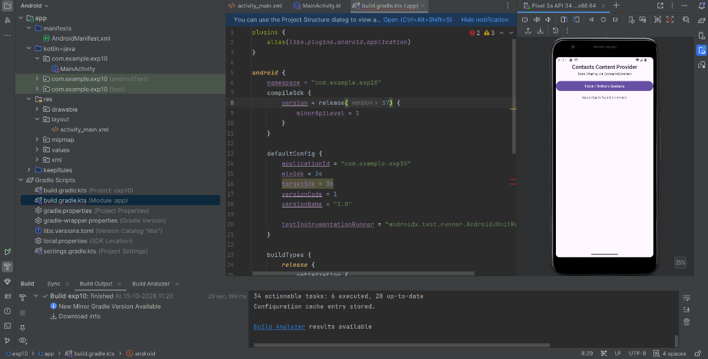

# Experiment 10: Contacts Content Provider

An Android application demonstrating data sharing in Android using **Content Providers** and **Content Resolvers**. The app queries the device's contacts via `ContactsContract` and displays them in a structured list while handling runtime permissions cleanly.

---

## 📱 Features

- **Runtime Permissions**: Requests `android.permission.READ_CONTACTS` safely using AndroidX `ActivityResultContracts.RequestPermission()`.
- **Content Provider Integration**: Queries `ContactsContract.CommonDataKinds.Phone.CONTENT_URI` using Android's `ContentResolver`.
- **Data Projection & Query**: Retrieves contact display names and telephone numbers sorted alphabetically in ascending order.
- **Dynamic UI**: Uses a responsive `ConstraintLayout` with `ListView` and `ArrayAdapter` to display contact items.
- **State Feedback**: Displays real-time status feedback for:
  - Default initial state
  - Permission denied message
  - "No contacts found on device" empty state
  - Number of contacts successfully loaded

---

## 📸 Screenshots

| 1. Permission Request Dialog | 2. Contacts Display / Empty State |
| :---: | :---: |
|  |  |

---

## 🛠️ Tech Stack & Requirements

- **Language**: Kotlin
- **Minimum SDK**: API 24 (Android 7.0)
- **Target SDK**: API 36
- **Compile SDK**: API 37
- **Development Tool**: Android Studio Ladybug / Koala or newer
- **Build System**: Gradle with Kotlin DSL (`build.gradle.kts`)

---

## 🚀 How to Run the Project

1. **Clone the repository** and checkout the `exp10` branch:
   ```bash
   git clone -b exp10 https://github.com/joylynprincita-ai/Android-studio-.git
   ```
2. Open the project folder in **Android Studio**.
3. Allow Gradle to sync dependencies and build the project.
4. Run the app on an Android Emulator or connected physical device running Android 7.0 (API 24) or higher.
5. Tap **"Fetch / Refresh Contacts"** and grant contact permissions when prompted.

---

## 👤 Author

- **joylynprincita**
