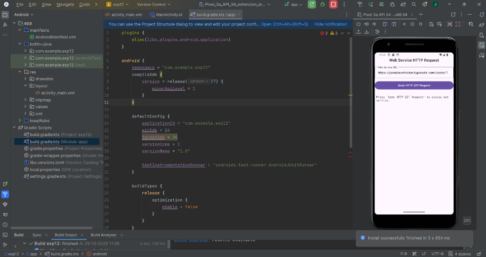
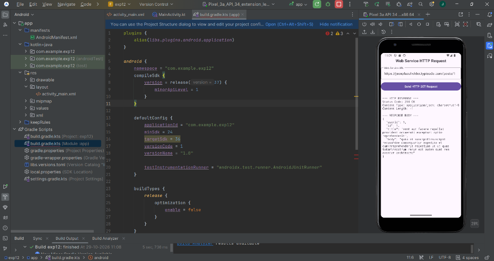

# Experiment 12: Web Service HTTP Request

An Android application built with **Kotlin** that demonstrates how to interact with RESTful web services over HTTP. It performs asynchronous HTTP GET requests using `HttpURLConnection` and Kotlin Coroutines (`lifecycleScope`), parses and formats HTTP response metadata (Status Code, Content-Type, Content-Length), and renders the JSON response body in real time.

---

## 📱 Screenshots

| Initial Application Screen | HTTP GET Response Received |
| :---: | :---: |
|  |  |
| *Default URL loaded, ready to dispatch request* | *HTTP 200 OK response with headers & formatted JSON body* |

---

## 🚀 Features

- **Dynamic REST Endpoint Configuration**: Allows testing any custom HTTP/HTTPS API endpoint (pre-configured with JSONPlaceholder: `https://jsonplaceholder.typicode.com/posts/1`).
- **Asynchronous Network Operations**: Uses Kotlin Coroutines (`Dispatchers.IO`) to execute network requests off the main thread, keeping the UI completely responsive.
- **Comprehensive Response Inspection**:
  - HTTP Status Code & Status Message (e.g., `200 OK`)
  - Content-Type header (e.g., `application/json; charset=utf-8`)
  - Content-Length header
  - Full formatted JSON response body
- **Interactive UI & State Feedback**:
  - Real-time `ProgressBar` indicator during active network transactions.
  - Button state management to prevent duplicate concurrent requests.
  - Scrollable `TextView` styled with monospace typography for readable JSON viewing.
- **Graceful Error Handling**: Captures network timeouts, malformed URLs, and server error responses (`errorStream`).

---

## 🛠️ Tech Stack & Specifications

- **Language**: Kotlin
- **Minimum SDK**: API 24 (Android 7.0 Nougat)
- **Target SDK**: API 36
- **Compile SDK**: API 37
- **UI Architecture**: XML Layouts with Material 3 Components (`ConstraintLayout`, `TextInputLayout`, `MaterialButton`)
- **Concurrency**: Kotlinx Coroutines (`lifecycleScope.launch(Dispatchers.IO)`)
- **Networking**: `java.net.HttpURLConnection`, `java.net.URL`
- **Permissions**: `android.permission.INTERNET`

---

## 📂 Project Structure

```text
exp12/
├── app/
│   ├── src/
│   │   ├── main/
│   │   │   ├── java/com/example/exp12/
│   │   │   │   └── MainActivity.kt          # Main activity handling network calls & UI
│   │   │   ├── res/
│   │   │   │   ├── layout/
│   │   │   │   │   └── activity_main.xml    # UI layout with URL input, button & scrollable text
│   │   │   │   ├── values/
│   │   │   │   │   ├── strings.xml          # UI string resources
│   │   │   │   │   ├── colors.xml           # Color palette definitions
│   │   │   │   │   └── themes.xml           # App theme definitions
│   │   │   └── AndroidManifest.xml          # Declares INTERNET permission & launcher activity
│   │   └── build.gradle.kts                 # App-level build configuration
├── screenshots/
│   ├── app_initial_ui.png                   # Initial screen screenshot
│   └── app_response_data.png                # Result screen screenshot
├── build.gradle.kts                         # Project-level build configuration
├── settings.gradle.kts                      # Project settings & repositories
└── README.md                                # Project documentation
```

---

## ⚙️ How to Build and Run

1. **Clone the Repository**:
   ```bash
   git clone -b exp12 https://github.com/joylynprincita-ai/Android-studio-.git
   cd Android-studio-
   ```

2. **Open in Android Studio**:
   - Launch **Android Studio**.
   - Select **Open** and select the cloned project directory.

3. **Sync Gradle**:
   - Wait for Android Studio to sync Gradle and download required dependencies.

4. **Run the App**:
   - Connect a physical Android device (with USB debugging enabled) or start an Android Virtual Device (AVD).
   - Click the green **Run** button (`Shift + F10`) or navigate to `Run > Run 'app'`.

---

## 👤 Author

- **joylynprincita**
