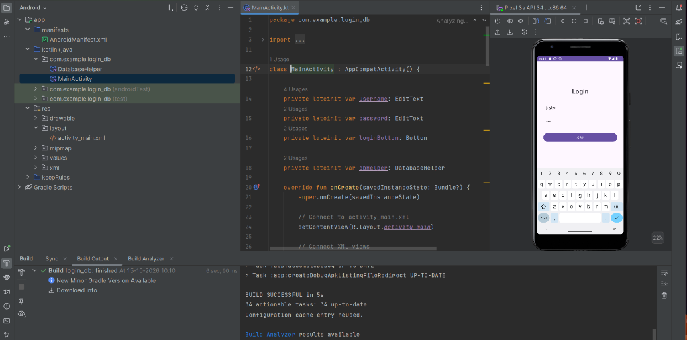
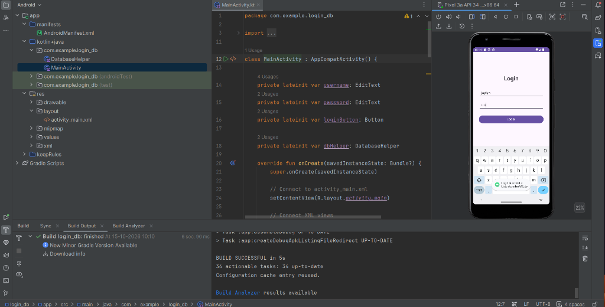
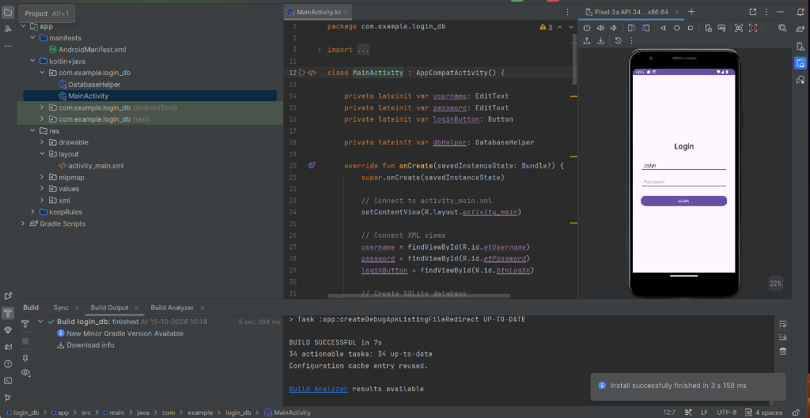
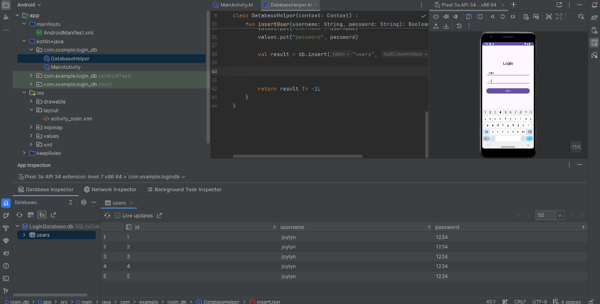

# Experiment 9: Android SQLite Database & SharedPreferences Login Application 📱💾

An Android application built with **Kotlin** and **Android Studio**, demonstrating offline local data persistence using **SQLite (`SQLiteOpenHelper`)** and **SharedPreferences**.

---

## 📌 Project Overview

This project showcases a complete authentication and data storage workflow in an Android application:
1. **User Interface (`activity_main.xml`)**: A clean login screen featuring input fields for Username and Password with masked secure password entry.
2. **Persistent Username Caching (`SharedPreferences`)**: Remembers and pre-populates the last entered username across application restarts using a real-time `TextWatcher`.
3. **Relational Data Storage (`SQLiteDatabase`)**: Stores login credentials (`username` and `password`) into a local SQLite database named `LoginDatabase.db` inside a table named `users`.
4. **Interactive User Feedback**: Notifies the user of validation errors and successful database operations via Android `Toast` notifications.
5. **Database Inspection**: Verified live data insertion using Android Studio's **App Inspection / Database Inspector** tool.

---

## 📸 Screenshots & Demonstrations

| 1. Login Interface | 2. Database Insertion Toast |
| :---: | :---: |
|  |  |
| *Login interface with username and masked password input* | *Toast message confirming successful insertion into SQLite* |

| 3. MainActivity Implementation | 4. SQLite Database Inspector |
| :---: | :---: |
|  |  |
| *Android Studio IDE showing view binding & logic* | *Live App Inspection displaying `users` table records* |

---

## 🗄️ Database Architecture

The application uses an SQLite database named **`LoginDatabase.db`** (Version 1).

### Schema (`users` Table)
```sql
CREATE TABLE users (
    id INTEGER PRIMARY KEY AUTOINCREMENT,
    username TEXT,
    password TEXT
);
```

| Column | Type | Constraints | Description |
| :--- | :--- | :--- | :--- |
| `id` | `INTEGER` | `PRIMARY KEY AUTOINCREMENT` | Unique identifier for each entry |
| `username` | `TEXT` | - | The user's entered username |
| `password` | `TEXT` | - | The user's entered password |

---

## 🛠️ Code Highlights

### 1. `DatabaseHelper.kt`
Handles database creation, version management, and CRUD operations:
```kotlin
class DatabaseHelper(context: Context) :
    SQLiteOpenHelper(context, "LoginDatabase.db", null, 1) {

    override fun onCreate(db: SQLiteDatabase) {
        db.execSQL(
            "CREATE TABLE users (" +
                    "id INTEGER PRIMARY KEY AUTOINCREMENT, " +
                    "username TEXT, " +
                    "password TEXT)"
        )
    }

    override fun onUpgrade(db: SQLiteDatabase, oldVersion: Int, newVersion: Int) {
        db.execSQL("DROP TABLE IF EXISTS users")
        onCreate(db)
    }

    fun insertUser(username: String, password: String): Boolean {
        val db = writableDatabase
        val values = ContentValues().apply {
            put("username", username)
            put("password", password)
        }
        val result = db.insert("users", null, values)
        return result != -1L
    }
}
```

### 2. `MainActivity.kt`
Handles UI view binding, SharedPreferences caching, and login submission:
```kotlin
// Save username whenever user types
username.addTextChangedListener(object : TextWatcher {
    override fun beforeTextChanged(s: CharSequence?, start: Int, count: Int, after: Int) {}
    override fun onTextChanged(s: CharSequence?, start: Int, before: Int, count: Int) {
        preferences.edit().putString("username", s.toString()).apply()
    }
    override fun afterTextChanged(s: Editable?) {}
})

// Store credentials in SQLite on button click
loginButton.setOnClickListener {
    val user = username.text.toString()
    val pass = password.text.toString()

    if (user.isEmpty() || pass.isEmpty()) {
        Toast.makeText(this, "Please enter username and password", Toast.LENGTH_SHORT).show()
    } else {
        val result = dbHelper.insertUser(user, pass)
        if (result) {
            Toast.makeText(this, "Login successful\nData stored in SQLite", Toast.LENGTH_LONG).show()
        } else {
            Toast.makeText(this, "Failed to store data", Toast.LENGTH_SHORT).show()
        }
    }
}
```

---

## 📂 Project Structure

```
login_db/
├── app/
│   ├── src/
│   │   └── main/
│   │       ├── AndroidManifest.xml
│   │       ├── java/com/example/login_db/
│   │       │   ├── DatabaseHelper.kt      # SQLiteOpenHelper implementation
│   │       │   └── MainActivity.kt        # UI logic, SharedPreferences, validation
│   │       └── res/
│   │           ├── layout/
│   │           │   └── activity_main.xml  # Login screen layout
│   │           └── values/
│   │               ├── colors.xml
│   │               ├── strings.xml
│   │               └── themes.xml
│   └── build.gradle.kts
├── gradle/
├── screenshots/                           # Project output & IDE screenshots
│   ├── 01_login_screen.png
│   ├── 02_login_success_toast.png
│   ├── 03_main_activity_code.png
│   └── 04_database_inspector.png
├── .gitignore
├── build.gradle.kts
├── gradle.properties
├── gradlew
├── gradlew.bat
├── settings.gradle.kts
└── README.md
```

---

## 🚀 Getting Started

### Prerequisites
* **Android Studio** (Koala / Ladybug or newer recommended)
* **JDK 17** or higher
* **Android Emulator / Physical Device** (API level 24+)

### Steps to Run
1. Clone this repository and checkout the `exp9` branch:
   ```bash
   git clone -b exp9 https://github.com/joylynprincita-ai/Android-studio-.git
   ```
2. Open the project folder in **Android Studio**.
3. Allow Gradle to sync the dependencies.
4. Select a virtual device (e.g., Pixel 3a API 34) and click **Run 'app'** (`Shift + F10`).
5. Enter a username and password, then tap **LOGIN**.
6. View the stored entries in Android Studio via **View > Tool Windows > App Inspection > Database Inspector**.

---

## 👤 Author

* **[joylynprincita-ai](https://github.com/joylynprincita-ai)**
