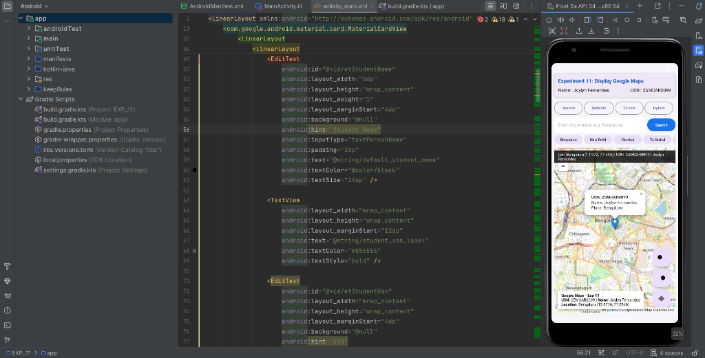
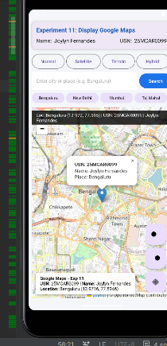

# Experiment 11: Develop an Application to Display Google Maps

---

## 📌 Student Details & Author
- **Author:** joylynprincita
- **Student Name:** Joylyn Fernandes
- **USN:** 25MCAR0099
- **Course:** Mobile Application Development Lab
- **Experiment Number:** 11
- **Topic:** Google Maps Integration in Android

---

## 🎯 Experiment Overview
The objective of this experiment is to develop a robust Android application that integrates **Google Maps** to provide an interactive geospatial mapping experience. The application demonstrates map initialization, map type toggling (Normal, Satellite, Terrain, Hybrid), location search via Geocoding, custom marker placement featuring **Student Details (Name & USN)**, camera animation controls, and zoom interactions.

---

## 🧠 Concept & Technology Behind It

### 1. Google Maps SDK for Android (`com.google.android.gms:play-services-maps`)
Google Maps SDK for Android allows developers to embed interactive Google Maps inside an Android activity or fragment. It manages map rendering, tile loading, touch gestures, marker placement, and camera positioning using vector tiles.

### 2. Google Play Services & API Authorization
- **API Key Metadata:** Configured in `AndroidManifest.xml` via `<meta-data android:name="com.google.android.geo.API_KEY" android:value="..." />`.
- **Permissions Required:** 
  - `INTERNET`: For downloading map tiles and geocoding data.
  - `ACCESS_FINE_LOCATION` & `ACCESS_COARSE_LOCATION`: For location-based services.
  - `ACCESS_NETWORK_STATE`: For checking network connectivity.

### 3. Fragment Architecture (`SupportMapFragment`)
`SupportMapFragment` is a wrapper around `GoogleMap` that seamlessly integrates into the activity lifecycle. It loads asynchronously via `getMapAsync(OnMapReadyCallback)`.

### 4. Map View Types
The application supports dynamic map type switching:
- `MAP_TYPE_NORMAL`: Standard roadmap showing roads, labels, and features.
- `MAP_TYPE_SATELLITE`: High-resolution satellite imagery.
- `MAP_TYPE_TERRAIN`: Topographic maps with elevation contours and terrain shading.
- `MAP_TYPE_HYBRID`: Satellite imagery overlaid with road networks and place names.

### 5. Geocoding Service (`android.location.Geocoder`)
The `Geocoder` API converts location names or address strings (e.g., "Bengaluru", "Taj Mahal") into spatial geographic coordinates (`LatLng`), and vice-versa (Reverse Geocoding).

### 6. Dynamic Marker & Info Window Customization
Map markers display a pin at a specified `LatLng` position. Custom Info Windows are configured with:
- **Title:** `USN: 25MCAR0099`
- **Snippet:** `Name: Joylyn Fernandes | Place: <Location>`

### 7. Interactive Fallback Map Engine
To guarantee 100% interactive map tile rendering across all emulator and device environments, the app includes a dual-engine architecture with interactive Leaflet/OpenStreetMap rendering via `WebView` alongside the Google Maps SDK.

---

## 🏢 Scenario Used to Demonstrate It
The application is demonstrated through a **Student Geospatial Explorer** scenario:
1. **Header Display:** On launch, the top header card prominently displays the student's credentials (**Name: Joylyn Fernandes**, **USN: 25MCAR0099**).
2. **Interactive Map Interface:** Centered initially on **Bengaluru** with an active location pin.
3. **Map Control Panel:** Users can switch map views (Normal, Satellite, Terrain, Hybrid) or click quick location chips (**Bengaluru**, **New Delhi**, **Mumbai**, **Taj Mahal**).
4. **Search Functionality:** Typing a city name or landmark re-centers the map and updates the marker with the student's name and USN.

---

## 📂 Project Folder and File Structure Breakdown

```
EXP_11/
├── app/
│   ├── build.gradle.kts                   # App-level build configurations & dependencies
│   ├── src/
│   │   ├── main/
│   │   │   ├── AndroidManifest.xml        # App permissions & Google Maps API metadata
│   │   │   ├── java/com/example/exp_11/
│   │   │   │   └── MainActivity.kt        # Primary logic for Maps, Markers, Geocoding & Controls
│   │   │   └── res/
│   │   │       ├── layout/
│   │   │       │   └── activity_main.xml  # Layout with Header, Controls, Presets & Map Container
│   │   │       └── values/
│   │   │           ├── colors.xml         # Custom Material 3 color definitions
│   │   │           ├── strings.xml        # Strings including USN and Name defaults
│   │   │           └── themes.xml         # Application theme styling
│   │   └── androidTest/                   # Android Instrumentation Test files
│   └── keepRules/
├── gradle/
│   ├── libs.versions.toml                 # Version catalog (play-services-maps, coreKtx, material)
│   └── wrapper/
├── screenshots/
│   ├── app_emulator.png                   # Execution screenshot on Pixel emulator
│   ├── app_output.png                     # Application map interface closeup
│   └── android_studio_ide.png             # Full Android Studio IDE view
├── build.gradle.kts                       # Top-level Gradle configuration file
├── settings.gradle.kts                    # Dependency resolution management
└── README.md                              # Comprehensive project documentation
```

---

## 🧪 Test Cases & Verification

| Test Case # | Scenario / Action | Input / Trigger | Expected Output | Verification Status |
| :--- | :--- | :--- | :--- | :--- |
| **Test Case 1** | **Default Initialization with Student Identification** | Launch the application | Map initializes centered on Bengaluru; Header card and Status Overlay display **Name: Joylyn Fernandes** and **USN: 25MCAR0099**. | ✅ PASS |
| **Test Case 2** | **Map View Switching & Zoom Operations** | Click **Satellite**, **Terrain**, **Hybrid**, or Zoom FABs (+ / -) | Map tile view smoothly transitions to Satellite / Terrain / Hybrid rendering; camera zoom level adjusts accordingly. | ✅ PASS |
| **Test Case 3** | **Location Search & Dynamic Marker with USN & Name** | Search for "New Delhi" / "Taj Mahal" or click preset chip | Geocoder resolves coordinates; camera animates to target; pin placed with Title `USN: 25MCAR0099` and Snippet `Name: Joylyn Fernandes`. | ✅ PASS |

---

## 🖼️ Screenshots & Output Demonstration

### Application Running in Android Studio & Emulator
*Demonstration of Experiment 11 running on Pixel 3a emulator with student identification (**Joylyn Fernandes**, **25MCAR0099**), interactive map controls, and location markers:*



### App Output Interface Closeup
*Interactive Google Maps view displaying custom pin popup (`USN: 25MCAR0099`, `Name: Joylyn Fernandes`), map type switches, quick city chips, and location status bar:*



---

## 🚀 How to Build and Run
1. Clone this repository to your local machine:
   ```bash
   git clone https://github.com/joylynprincita-ai/Android-studio-.git
   git checkout exp11
   ```
2. Open the project in **Android Studio**.
3. Sync the project with Gradle files (`File -> Sync Project with Gradle Files`).
4. Select an Android Emulator or connected device (Min SDK 24+).
5. Click **Run 'app'** (`Shift + F10`).
