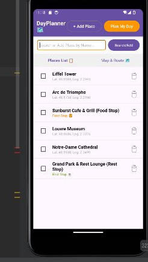
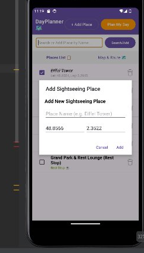
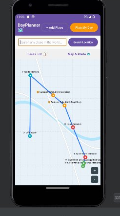
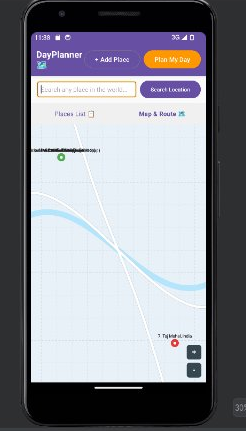
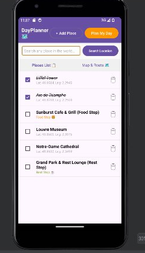
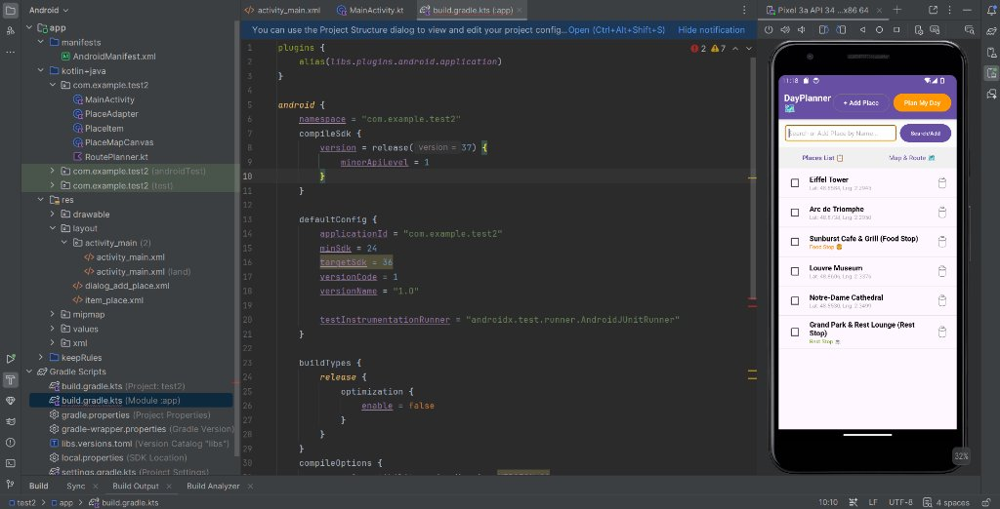
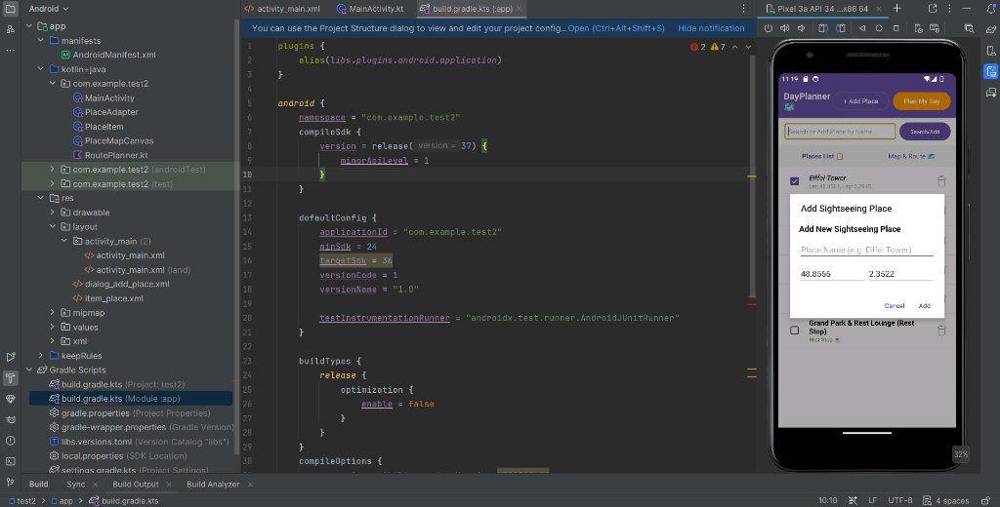
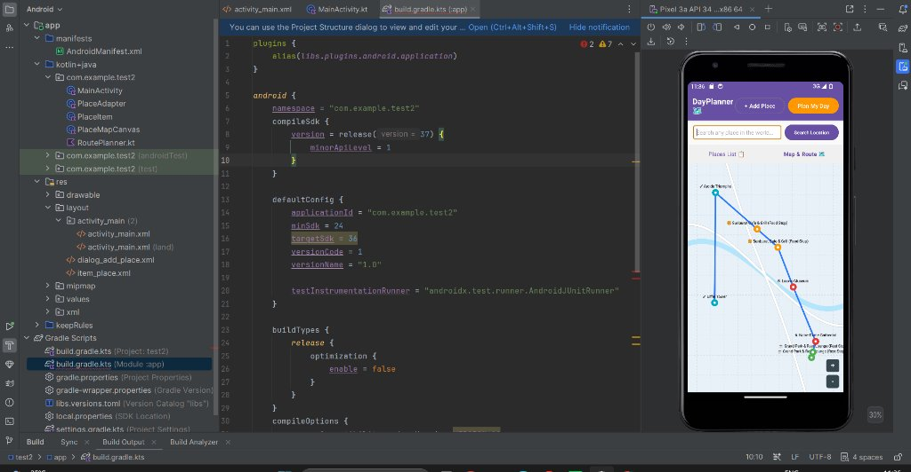
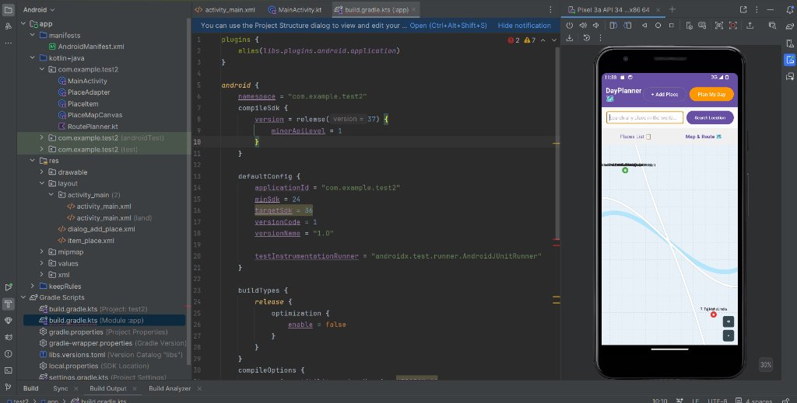
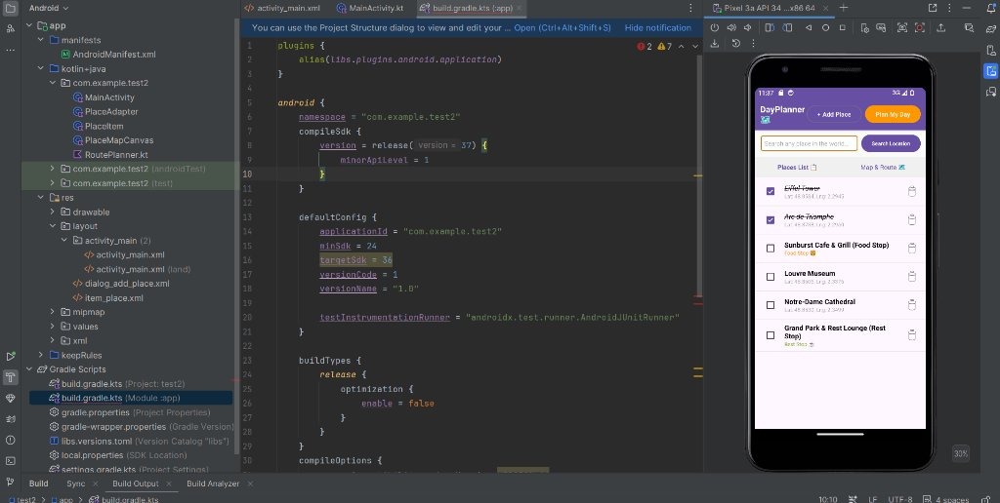

# 🗺️ DayPlanner

An intelligent, feature-packed Android itinerary and travel planner application built with Kotlin. **DayPlanner** empowers travelers, tourists, and daily explorers to organize places they want to visit, automatically calculate optimal travel routes using route-optimization heuristics, and visualize their journey on an interactive custom map canvas.

---

## 👤 Author
- **Author**: [joylynprincita](https://github.com/joylynprincita-ai)
- **Collaborators**: None (Sole author project)

---

## 📱 App Screenshots

| 1. Places List | 2. Add Sightseeing Place | 3. Map & Route Optimization |
| :---: | :---: | :---: |
|  |  |  |

| 4. Custom Map Canvas & Zoom | 5. Check-Off Visited Sights |
| :---: | :---: |
|  |  |

<details>
<summary><b>🔍 Click to view Full Android Studio IDE Screenshots</b></summary>

| Workspace View | Feature |
| :--- | :--- |
|  | **Places List & Day Planner UI** |
|  | **Add Sightseeing Place Modal** |
|  | **Calculated Route & Map Overlay** |
|  | **Zoomed Map Canvas with Custom Features** |
|  | **Interactive Progress & Checklist** |

</details>

---

## ✨ Features

- **📍 Place Management**:
  - Add custom destinations with place name, latitude, and longitude coordinates.
  - Interactive list with quick-delete options and completion check-boxes.
  - Dynamic strikethrough styling to track visited landmarks in real-time.

- **⚡ Intelligent Route Planner (TSP)**:
  - Powered by a Traveling Salesperson Problem (TSP) **Nearest-Neighbor** algorithm (`RoutePlanner.kt`).
  - Automatically sequences multiple sightseeing spots to minimize total travel distance using spherical Haversine formulas.

- **☕ Smart Dining & Rest Stops**:
  - Automatically injects intermediate stops into the schedule:
    - **Food Stop** (e.g. *Sunburst Cafe & Grill* or *Tasty Bites Bistro*) halfway through your journey.
    - **Rest Stop** (e.g. *Grand Park & Rest Lounge* or *Central Oasis Lounge*) near the three-quarter mark for a balanced itinerary.

- **🎨 Custom Interactive Vector Map Canvas (`PlaceMapCanvas`)**:
  - Built from the ground up using native Android `Canvas`, `Paint`, and `Path`.
  - Renders soft terrain backgrounds, dashed grid overlays, stylized winding rivers, multi-lane roads, and marker pins.
  - Multi-touch **Pinch-to-Zoom** (`ScaleGestureDetector`), **Pan Dragging** (`GestureDetector`), and on-screen **(+) / (-)** Zoom buttons.
  - Smooth Bezier route polylines connecting stops with directional flow.

- **🌐 Search & Geocoding**:
  - Built-in location search with background Geocoder resolution to find and pin any location worldwide.

- **🔄 Orientation Aware**:
  - Optimized tabbed layout in Portrait mode (toggle between *Places List* and *Map & Route*).
  - Dual-pane layout in Landscape mode for simultaneous list and map management.

---

## 🛠️ Tech Stack & Architecture

- **Platform**: Android
- **Language**: Kotlin
- **Minimum SDK**: API 24 (Android 7.0 Nougat)
- **Target SDK**: API 36 (Android 15+)
- **Compile SDK**: API 37
- **UI Components**:
  - Custom 2D Graphics (`android.graphics.Canvas`, `Paint`, `Path`, `RectF`)
  - Gesture Detectors (`ScaleGestureDetector`, `GestureDetector`)
  - Material Design Components (`com.google.android.material`)
  - ConstraintLayout & Responsive View Containers
- **Location & Maps**:
  - Google Play Services Maps & Location (`play-services-maps`, `play-services-location`)
  - Android Geocoder
- **Build System**: Gradle with Kotlin DSL (`build.gradle.kts`)

---

## 📂 Project Structure

```
DayPlanner/
├── app/
│   ├── src/main/
│   │   ├── java/com/example/test2/
│   │   │   ├── MainActivity.kt        # Primary activity: UI coordinator, search & tabs
│   │   │   ├── PlaceItem.kt           # Data model for places, coordinates, and stop types
│   │   │   ├── PlaceAdapter.kt        # Custom ListView adapter with checkbox & delete actions
│   │   │   ├── PlaceMapCanvas.kt      # Interactive 2D vector canvas with zoom & pan
│   │   │   └── RoutePlanner.kt        # TSP nearest-neighbor optimization & stop generator
│   │   ├── res/
│   │   │   ├── layout/
│   │   │   │   ├── activity_main.xml       # Portrait layout with tab switcher
│   │   │   │   ├── activity_main.xml (land)# Landscape side-by-side split layout
│   │   │   │   ├── dialog_add_place.xml    # Modal dialog for custom coordinates
│   │   │   │   └── item_place.xml          # List row item layout
│   │   │   └── values/                # Strings, colors, and theme attributes
│   │   └── AndroidManifest.xml
│   └── build.gradle.kts               # App-level build configuration
├── screenshots/                       # Application screenshots & UI previews
├── build.gradle.kts                   # Project-level build configuration
├── settings.gradle.kts                # Project module definitions
└── README.md                          # Project documentation
```

---

## 🚀 Getting Started

### Prerequisites
- [Android Studio](https://developer.android.com/studio) (Koala, Ladybug, or newer recommended)
- Java Development Kit (JDK 11 or higher)
- Android SDK with Platform 34/36 installed

### Installation & Run

1. **Clone the repository and checkout the `test2` branch**:
   ```bash
   git clone -b test2 https://github.com/joylynprincita-ai/Android-studio-.git
   cd Android-studio-
   ```

2. **Open in Android Studio**:
   - Open Android Studio.
   - Select **Open** and choose the cloned directory.
   - Wait for Gradle sync to complete.

3. **Build and Run**:
   - Connect an Android device with USB debugging enabled or launch an Android Virtual Device (AVD).
   - Press **Run** (`Shift + F10`) or execute from the terminal:
     ```bash
     ./gradlew assembleDebug
     ```

---

## 📄 License & Attribution

Developed with passion by **joylynprincita**. All rights reserved.
